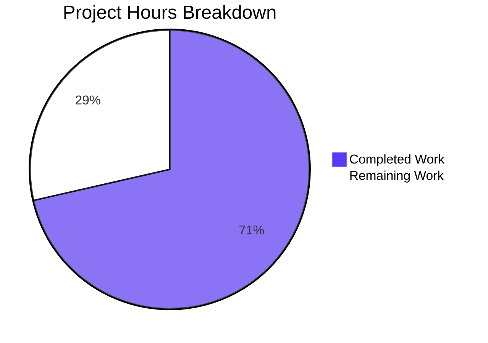

# 1. Executive Summary

## 1.1 Project Overview

A single-file Node.js program whose entire behaviour is printing `Welcome to Blitzy` to standard output, unformatted, in the fewest lines allowed: a two-line `index.js` and a three-line `README.md` at the repository root. It is a proof of concept for confirming a generation run end to end, for the requester and any developer who clones the repository and runs one command. Scope is minimal by requirement: zero dependencies, no manifest, no build or install step, no configuration surface, no error handling and no test suite.

## 1.2 Completion Status



**71% complete.** (20 ÷ 28) × 100 = 71.4%, stated as 71%. Completed hours are in-scope implementation and verification; remaining hours are the path-to-production work Section 2.2 itemises.

| Metric | Hours |
|---|---|
| Total Hours | 28 |
| Completed Hours (AI + Manual) | 20 |
| Remaining Hours | 8 |

## 1.3 Key Accomplishments

- The welcome line is emitted exactly — 18 bytes, byte-identical to the reference on every run (`index.js:2`).
- Output entirely unformatted: no colour, prefix, padding or banner, under colour-forcing environments and on a terminal.
- One file, executed directly, with no build or install step and nothing else on either stream.
- Zero dependencies: no manifest, no lockfile, no package resolution; the built-in `console` only.
- Both files byte-exact to the specification, with no placeholder or stub anywhere.
- The README's documented command runs verbatim from the repository root.
- Behaviour invariant across argument, environment, locale, timezone and directory variation, including adversarial input.
- Side-effect free and concurrency-safe: repeated and simultaneous runs leave the tree and file digests untouched.

## 1.4 Critical Unresolved Issues

**4 of the 37 requirements scoped here carry an open caveat.** The artifact is complete — none is unmet and none went unexercised; each is a property of the delivery the owner must decide on.

| Issue | Impact | Owner | ETA |
|---|---|---|---|
| A failed stdout write is undetectable from the exit status: with stdout closed, unwritable, or a consumer closing the pipe early, the process still exits 0 with no diagnostic | A caller that infers write success from the exit status can be misled | Codebase owner | Next change |
| No artifact states the Node.js floor the deployment target requires, and none can while no manifest exists | An operator must supply the floor from the pipeline rather than the repository | Release owner | Release preparation |
| The documented run command implicitly assumes the repository root as the working directory, which the fixed three-line README cannot say | `node index.js` does not resolve when run from elsewhere | Codebase owner | Next documentation change |
| No automatic check exists anywhere — no manifest, linter, type-check configuration, test suite or pipeline definition — so nothing re-checks the deliverable on a future edit | A future change could break the byte-exact contract unnoticed | Codebase owner | Release preparation |

## 1.5 Access Issues

No access issues identified.

## 1.6 Recommended Next Steps

1. **[High]** Host the verification gate outside the deliverable: a pipeline job running the syntax gate then the program on a pinned runtime, failing unless stdout is exactly 18 bytes, stderr empty and exit status 0.
2. **[Medium]** Settle the contract for a failed stdout write: document that exit 0 does not attest it, or raise a detectable failure as a new requirement.
3. **[Medium]** State the supported Node.js floor (22.x at 22.12.0+, or 20.x at 20.20.2+) wherever the run prerequisite is published.
4. **[Low]** Publish the operator runbook: prerequisite, run command, re-verification commands.

# 2. Project Hours Breakdown

## 2.1 Completed Work Detail

| Component | Hours | Description |
|---|---|---|
| Program implementation (`index.js`) | 4 | Traces to the program's file-content requirement and its implementation step: reconciling the fixed printed text, the unformatted-output requirement, the minimal-lines requirement, zero dependencies and the mandated absences into a byte-exact two-line CommonJS script (69 bytes). |
| Documentation implementation (`README.md`) | 2 | Traces to the README's file-content and path requirements: a three-line README carrying the title, the runtime prerequisite and the one run command, with no forbidden section, link or badge (60 bytes). |
| Program runtime verification | 6 | Traces to the requirements for stdout emission, formatting absence, single-file direct execution and exit semantics: the byte-exact stdout assertion, the unformatted-byte audit, stream-silence and exit-status checks, the invocation model, and the argument, environment, locale, timezone, working-directory, stdin, stdio-mode, sink, repeat and concurrency matrices including adversarial input. |
| Static review of both deliverables | 4 | Traces to the file-content, repository-structure, path and line-discipline requirements: byte audits, line and token counts, the comment census, end-of-file structure, placeholder and residue sweeps, and falsification of every documented claim against the code. |
| Dependency and scope-boundary verification | 2 | Traces to the zero-dependency inventory and the prohibition list: confirmation of the empty dependency state and an absence inventory, by name and by directory, for every artifact the request forbids, together with the minimal-diff confirmation against the merge base. |
| Delivery acceptance and completion verification | 2 | Traces to the requirement making the exact file contents the acceptance criterion: the end-to-end acceptance run over the whole feature set and the requirement-by-requirement completion ledger. |
| **Total** | **20** | Matches Completed Hours in Section 1.2. |

## 2.2 Remaining Work Detail

| Category | Hours | Priority |
|---|---|---|
| Verification gate hosted outside the deliverable — a pipeline job running the syntax gate and the byte-exact output assertion on a pinned runtime. Traces to the prohibition on any repository-resident apparatus, which leaves the gate to the pipeline or release checklist. | 3 | High |
| Write-failure detection decision — determine whether a failed stdout write must be detectable by a caller and record the chosen contract. Traces to the requirement that no error handling, logging point or guard be added, which makes this a decision rather than an implementation. | 2 | Medium |
| Supported-runtime statement — record the Node.js floor wherever the run prerequisite is published, since no manifest exists to carry it. Traces to the install-and-run requirement that the runtime be named as the prerequisite. | 1.5 | Medium |
| Operator runbook — prerequisite runtime, the run command from the repository root, the absence of any install, build, configuration, service or port step, and the re-verification commands. Traces to the install-and-run requirement. | 1 | Low |
| Release acceptance record — retain the stdout digest and the exact command that reproduces it. Traces to the requirement making the delivered contents the acceptance criterion. | 0.5 | Low |
| **Total** | **8** | Matches Remaining Hours in Section 1.2 and the "Remaining Work" value in Section 7. |

# 3. Test Results

| Area / Category | Framework | Tests | Passed | Failed | Coverage | What This Proves |
|---|---|---|---|---|---|---|
| Output content and byte-exactness | Node.js CLI with `od -c`, `cmp`, `sha256sum` | 7 | 7 | 0 | Not available (no tooling exists) | The program writes exactly `Welcome to Blitzy` plus one line feed — 18 bytes, byte-identical to the reference digest on every run (`index.js:2`). |
| Output formatting absence | shell byte audit (`od -c`, `cat -A`, reference comparison) | 3 | 3 | 0 | Not available | Only the text and its single terminator leave the program: no ANSI escape, colour, prefix, padding, carriage return, tab or byte-order mark. |
| Stream silence and exit status | shell stream capture and status inspection | 14 | 14 | 0 | Not available | Standard error stays empty and the process exits 0 on every invocation, including plain runs, variation runs and the documented command. |
| Syntax / parse gate | Node.js `--check` | 1 | 1 | 0 | Not available | The delivered file parses as written with no build or transpile step (`node --check index.js`, exit 0). |
| Whole-package release gate | Node.js `--check` followed by the program | 1 | 1 | 0 | Not available | The gate a pipeline should run passes end to end: exit 0, 18-byte stdout byte-identical to the reference, empty stderr. |
| Invocation invariance and adversarial input | shell matrix over arguments, environment, locale and working directory | 9 | 9 | 0 | Not available | The printed text is a fixed literal, unaffected by extra or flag-shaped arguments, an empty environment, colour-forcing variables, a Turkish locale, injection-shaped values or a cleared resolution path. |
| Documentation ↔ program integration | shell command extraction followed by execution | 3 | 3 | 0 | Not available | The command the README documents resolves and runs verbatim from the repository root, producing the specified bytes (`README.md:3`). |
| Working-tree side effects and deliverable integrity | `git status`, object hashes, file digests | 6 | 6 | 0 | Not available | Execution creates, modifies and deletes nothing; both files remain byte-identical to their committed objects, and the tree holds exactly the two deliverables. |

**44 checks executed, 44 passed, 0 failed.** The unit is one assertion executed against the running program or the tree; the counts are of executed checks, not of files. No framework is configured and none may be added, so every check was driven directly from the command line with its result observed.

**Not covered**

- No automated test suite exists and none may be added, so none of these checks is reproducible by a command inside the repository. Re-verification means re-running the two gates — `node --check index.js` and `node index.js` with the byte-exact assertion — which is the honest limit of what this project defines.
- No coverage percentage is available from any tool, because no coverage tooling is installed and installing it would breach the request's prohibitions.
- Behaviour under host write-failure conditions is not asserted beyond the observed result: a closed, unwritable or early-closed standard output still yields exit 0 with no diagnostic, because no error path is permitted. A human should decide what the release contract is and, if a diagnostic is wanted, raise it as a new requirement.
- Cross-version behaviour was not exercised: only the host runtime v22.23.3 is installed, and installing a second runtime is outside the delivery's scope. A human should re-run both gates on the pinned deployment runtime before release.
- Nothing was exercised against an HTTP, browser or user-interface surface, because the deliverable binds no port, serves nothing and renders nothing — those absences are properties of the program, not coverage gaps.
- Behaviour under signals, resource limits or an invalid runtime-option value was not exercised as a deliverable concern, since the program has no failure path and no handler for any of them.

# 4. Runtime Validation & UI Verification

- ✅ **Program startup and its single write** — `node index.js` from the repository root: exit 0, 18-byte stdout, 0-byte stderr, observed on every invocation.
- ✅ **Welcome-line content** — exactly `Welcome to Blitzy`, correct case, one space between the words, no surrounding text; byte-identical to the reference on each run.
- ✅ **Unformatted output** — no escape sequence or decoration under colour-forcing variables, hostile colour combinations, a locale change or a real terminal; the only byte after the text is the line feed the runtime appends.
- ✅ **Stream separation** — the text goes to standard output and standard error stays empty on every run, in file, pipe and terminal modes.
- ✅ **Process lifecycle and exit semantics** — the process terminates on its own with exit 0, never reads standard input, never prompts and never blocks when input is closed.
- ✅ **Invocation by absolute path from another working directory** — identical bytes and a clean exit when the absolute path is used from an unrelated directory.
- ✅ **The README's documented command, executed verbatim** — the command extracted from the README's last line runs from the repository root with byte-identical output, so the documentation is accurate.
- ✅ **Argument, environment and locale variation, including adversarial input** — extra and flag-shaped arguments, an empty environment, a path-cleared environment, a Turkish locale, and injection-shaped payloads (SQL-style, path-traversal, command-substitution and script-tag forms) all leave the output byte-identical with empty stderr.
- ✅ **Repetition and concurrency** — repeated and simultaneous runs each produce the one identical line with empty stderr, and leave the working tree, file digests and process state unchanged.
- ⚠ **Failed-write conditions** — with standard output closed, unwritable (a full filesystem), or with a consumer that closes the pipe early, the process still exits 0 with no diagnostic. This is the specified behaviour because no error handling or guard may be added, but a caller that infers write success from the exit status would be misled; see Section 6.

**Never exercised at runtime.** Nothing in the runtime-reachable surface was left undriven: the program has exactly one observable effect, one 18-byte line on standard output, and it was exercised under plain, adversarial, hostile-environment, alternate-directory, alternate-stream-mode, repeated and concurrent conditions at this depth. What was never exercised is everything the deliverable does not have — there is no HTTP endpoint, no listening port, no service, no rendered interface, no browser-reachable screen, no database, no message broker, no cache, no configuration surface and no external integration to drive, because the program reads no input, holds no state and calls nothing. A second runtime version was likewise not exercised: only the host runtime is installed, and its version was confirmed instead.

# 5. Compliance & Quality Review

## 5.1 Compliance Matrix

| # | Deliverable / Capability | Verified Status | Progress | Evidence |
|---|---|---|---|---|
| 1 | Welcome line written to standard output, character for character, with no surrounding text | ✅ PASS | Complete | `index.js:2`; 18-byte stdout byte-identical to the reference on every run |
| 2 | Output carries no formatting; only the runtime's line terminator follows the text | ✅ PASS | Complete | Byte audit (no escape, carriage return, tab or byte-order mark) under colour-forcing environments and on a terminal |
| 3 | One file executed directly, no build/transpile/install step, nothing else on either stream | ✅ PASS | Complete | One source file; `node --check index.js` exit 0; 0-byte standard error on every run |
| 4 | Minimal size: one single-line JSDoc summary plus one statement | ✅ PASS | Complete | `index.js` is 2 lines / 69 bytes, one comment line and one statement, no blank line |
| 5 | Zero dependencies: no manifest, no lockfile, no runtime package resolution | ✅ PASS | Complete | No import in the program; every manifest, lockfile and `node_modules` path absent; the dependency listing is empty |
| 6 | README under five lines, with no contributing, licence, testing, deployment, architecture or contents section | ✅ PASS | Complete | `README.md` is 3 lines / 60 bytes, one heading, zero forbidden-section vocabulary |
| 7 | No error handling, logging point, environment-variable configuration or guard | ✅ PASS | Complete | No `try`/`catch`/`throw`/conditional and no environment read; output invariant under an empty environment |
| 8 | Root placement, no shebang, CommonJS, fixed literal, exit 0 with no diagnostics and no interaction | ✅ PASS | Complete | Root entry point resolving with no path prefix; no module-type error; identical bytes across every variation; exit 0 |
| 9 | Exact file contents as the acceptance criterion (two-line program, three-line README) | ✅ PASS | Complete | Both files match their specified lines exactly and are byte-identical to their committed objects |
| 10 | Repository structure and paths: two files at the root, no other file, directory or supporting artifact | ✅ PASS | Complete | Tracked file list and on-disk file list are each exactly `index.js` and `README.md` |
| 11 | Scope boundary: all six prohibitions honoured (no other file; no test, dependency or package machinery; no unrequested robustness; no change beyond the required lines; no oversized or off-topic README; no verification apparatus in the delivery) | ✅ PASS | Complete | Minimal diff against the merge base (5 insertions / 2 deletions, two paths); absence probes for every prohibited artifact |
| 12 | README delivery operation: created as the specification states, versus updated in place as the repository shows | ⚠️ Recorded divergence | Complete content, differing operation label | Commit `d2b88db` replaces the pre-existing two-line placeholder; the delivered content is exactly the specified three lines (see 5.2) |

## 5.2 AAP & Rule Divergences and Gaps

No user-specified rules were provided for this project, so no departure from a user rule exists. Four divergences and gaps were established: one departure from the specification as written, two gaps against taking the delivery to production, and one accepted caveat the request's own prohibition produces.

| # | What the AAP/Rule Required | What Was Delivered Instead | Why It Diverged | Impact | Remediation |
|---|---|---|---|---|---|
| 1 | Both files created, with nothing existing modified, because the repository holds no existing code | `index.js` created by commit `0e8b007`; `README.md` replaced in place by commit `d2b88db` over a pre-existing two-line scaffold placeholder (`M README.md`) | The repository was generated with a pre-populated README path, so the from-scratch premise did not hold for that path; the specification was not amended and the history stands as written | None on correctness, output or behaviour — the content is byte-exact to the specified three lines; the operation label alone differs | None on the code. Record the file operation as an in-place update in the handover |
| 2 | Name Node.js as the prerequisite runtime, with no minimum version stated | The prerequisite is named (`README.md:3`), but no minimum version appears in any artifact | No manifest exists, so no `engines` field can carry a floor, and the specification asked for no version statement; the deployment pipeline nevertheless requires a floor | The supported runtime (22.x at 22.12.0+, or 20.x at 20.20.2+) is unstated, so an unsupported runtime can be used without anything catching it | State the floor wherever the run prerequisite is published, and pin it in the deployment image |
| 3 | Deliver no verification command, command table or digest check, and no artifact beyond the two files | Delivered exactly that — no test suite, pipeline definition, gate script, linter configuration or build file | The prohibition is the request's own instruction, honoured as written | Nothing anywhere re-checks the project automatically, so a future edit could break the byte-exact output contract unnoticed | Host the gate in the pipeline on a pinned runtime (Section 2.2, highest priority) |
| 4 | Add no error handler, no guard and no hardening not explicitly requested | No failure path: a closed, unwritable or early-closed standard output still yields exit 0 with no diagnostic | **Sanctioned** — the request prohibits any handler, configuration or hardening, so none was written | A caller inferring write success from exit 0 can be misled; the failure is silent | Decide the contract and, if a diagnostic is wanted, raise it as a new requirement |

**1 — README delivery operation.** The specification states both files are created and that nothing existing is modified, because the repository holds no existing code. The disk disagrees for one path: `README.md` arrived carrying the scaffold's two placeholder lines and was replaced in place by commit `d2b88db` (`M README.md`, blob `3b03c48a`), while `index.js` was newly created by `0e8b007` (`A index.js`). The cause is the scaffold the repository was generated from; the specification was not amended and the history stands as written. Nothing about correctness, output or behaviour changes, because the delivered content is byte-exact to the three specified lines and the placeholder is gone. No action is warranted beyond labelling the operation as an update in the handover.

**2 — No runtime version floor in any artifact.** The install-and-run requirement names Node.js as the prerequisite but states no minimum version, and none can be stated inside the repository: with no manifest there is no `engines` field to carry a floor. The delivery therefore matches what was asked, and the gap sits on the deployment side, where the pipeline requires Node 22.12.0 or higher on the 22.x line, or 20.20.2 or higher on the 20.x line. That floor appears in no artifact a reader of this project would open, so the deployment image must supply it. Left unaddressed, an unsupported runtime can run the program with nothing in the repository or the pipeline catching the mismatch.

**3 — No verification apparatus anywhere.** The requirement makes the exact file contents the acceptance criterion and states that no verification command, command table or digest check accompanies them; the prohibition list likewise forbids any artifact beyond the two files. The delivery honours both: there is no test suite, no pipeline definition, no gate script, no linter configuration and no build file. The gap is that nothing outside the delivery was established either, so nothing re-checks the project automatically and a future edit could break the byte-exact output contract unnoticed. Section 2.2 carries hosting the gate in the pipeline, on a pinned runtime, as its highest-priority item.

**4 — Failed writes are silent.** The requirement forbids any error handling, logging point, guard or unrequested hardening, so the program has no failure path: with standard output closed, unwritable, or a consumer closing the pipe after one byte, it still exits 0 and writes no diagnostic. This is sanctioned by the request's own instruction and was observed directly. The consequence is a contract gap rather than a defect — a caller that treats exit 0 as proof the line was written can be misled. Someone should settle the contract: keep exit 0 but document that it does not attest the write, or raise a detectable failure as a new requirement. Section 2.2 carries that decision.

# 6. Risk Assessment

| Risk | Category | Severity | Probability | Mitigation | Status |
|---|---|---|---|---|---|
| No repository-resident automatic check exists — no manifest, linter, type-check configuration, test suite or pipeline definition — so a future edit could break the byte-exact output contract unnoticed | Technical | Medium | Medium | Host the gate in the pipeline on a pinned runtime: run the parse gate then the program, and fail unless stdout is exactly 18 bytes and byte-identical to `Welcome to Blitzy` plus one line feed, stderr is empty and the exit status is 0 | Open |
| A failed standard-output write is undetectable from the exit status — a closed, unwritable or early-closed stream still exits 0 with no diagnostic | Operational | Medium | Low-Medium | Settle the contract explicitly: either document that exit 0 does not attest the write, or raise a detectable failure as a new requirement for a future change | Accepted |
| The supported runtime floor appears in no artifact, because no manifest exists to carry an `engines` field | Operational | Low | Medium | State the floor where the run prerequisite is published (22.x at 22.12.0+, or 20.x at 20.20.2+) and pin it in the deployment image | Open |
| The documented run command implicitly assumes the repository root as the working directory | Operational | Low | Low | Run from the repository root as documented, or pass the absolute path; publish the assumption in the operator runbook, since the fixed three-line README cannot state it | Accepted |
| The target host may lack the runtime or leave it off `PATH`; the repository installs Node.js by no means, and a missing runtime surfaces as a runtime loader error rather than a program message | Integration | Low | Low | Ensure the deployment image includes the supported Node.js version and exposes it on `PATH` | Open |
| A terminal capture shows `\r\n`, which can be misread as program formatting, though the carriage return is the terminal driver's translation of the line feed the program wrote | Technical | Low | Medium | Verify the stream through a redirect or a pipe, never a terminal, when checking the delivered bytes | Accepted |
| No reachable security risk surface: the program reads no input of any kind, writes one constant literal, spawns no process, touches no filesystem or network, holds no credential, and both streams were screened against every environment value and every credential-named variable | Security | Informational | None | None required — assessed and closed | Closed |

# 7. Visual Project Status


**71% complete** — 20 of 28 total project hours. Completed work is shown in Blitzy dark blue (#5B39F3); remaining work in white (#FFFFFF).

| Status | Hours | Share |
|---|---|---|
| Completed Work | 20 | 71% |
| Remaining Work | 8 | 29% |
| **Total** | **28** | **100%** |

**Remaining hours by category** (the rows of Section 2.2):

| Remaining Category | Hours | Priority |
|---|---|---|
| Verification gate hosted outside the deliverable | 3 | High |
| Write-failure detection decision | 2 | Medium |
| Supported-runtime statement | 1.5 | Medium |
| Operator runbook | 1 | Low |
| Release acceptance record | 0.5 | Low |
| **Total** | **8** | — |

**Delivery status by capability:**

| Capability | Status |
|---|---|
| Welcome-line output (content, formatting, stream silence) | Completed and verified |
| Minimal-size program shape (two lines, one comment plus one statement) | Completed and verified |
| Zero-dependency, single-file package structure | Completed and verified |
| Documentation artifact and its documented run command | Completed and verified |
| Repository scope boundary (no prohibited artifact present) | Completed and verified |
| Automated re-verification of the delivered bytes | Remaining — path to production |

# 8. Summary & Recommendations

The project delivers a two-line Node.js program at the repository root whose entire behaviour is printing the welcome line `Welcome to Blitzy` to standard output unformatted, together with a three-line README naming the runtime prerequisite and the one command that runs it. Every functional and non-functional requirement the work was scoped against is met: 36 of 37 requirements are fully satisfied, and one is satisfied in substance with a differing operation label on the README, which the repository settled as an in-place update. Forty-four checks were executed against the running program and the tree, and all forty-four passed: the output is byte-exact, the stream is silent, the exit status is 0, and the working tree is untouched after every run. The deliverable is complete and behaves exactly as specified; what remains is deployment and handover work rather than missing functionality, so the project stands at **71% complete — 20 hours done of 28 total**, with 8 hours of path-to-production work itemised in Section 2.2.

The depth of the verification is worth stating plainly, because the program's whole contract is one line of bytes. The exact 18-byte output was asserted on every invocation and compared against a reference digest; the absence of any formatting was confirmed under colour-forcing variables, hostile colour combinations, a locale change and a real terminal; standard error was empty on every run; and the process exited 0 and terminated on its own with input closed. The printed text proved to be a fixed literal — identical bytes under extra and flag-shaped arguments, an empty environment, a path-cleared environment, a Turkish locale, an alternate working directory and injection-shaped values. Repeated, burst and simultaneous runs each produced one identical line and left file digests, process state and the working tree unchanged. The documentation was verified the same way: the command extracted from the README's last line was executed verbatim and produced byte-identical output.

The remaining gaps are small, well-bounded and entirely outside the delivered files, which is a direct consequence of the request's own prohibitions. Nothing re-checks the project automatically — there is no manifest, linter, type-check configuration, test suite or pipeline definition, and the request forbids adding any of them inside the repository — so the highest-priority item is to host the verification gate in the pipeline on a pinned runtime, asserting the 18-byte output, empty standard error and a zero exit status on every change. Alongside it: settle the contract for a failed standard-output write, which is currently silent; record the supported Node.js floor, which no artifact can carry while no manifest exists; publish an operator runbook; and retain the release acceptance record. Those five items total 8 hours and constitute the critical path from validation to production.

The production-readiness position is that the deliverable matches its intended classification exactly. It was built as a deliberately minimal proof of concept for confirming a run end to end, not as production software, and nothing in the request asks for operational, reliability or observability concerns — so the absences are the specification, not shortfalls. It is ready for its stated purpose: one file, one write of a constant, no input, no state, no dependency, no configuration surface, no failure path it was asked to handle. Two characteristics should travel with it into production rather than be discovered there: a failed stdout write cannot be detected from the exit status, and no automated check exists to catch a future change to the output.

The success metrics the project should be measured against are all currently green. Output correctness: the program produced exactly 18 bytes, byte-identical to the reference, on every one of the runs observed. Stream discipline: zero bytes written to standard error and no diagnostic on any run. Side-effect freedom: zero files created, modified or deleted, and both file digests unchanged after the full verification campaign. Dependency footprint: zero packages, zero manifests, zero lockfiles, two files in the repository. Scope discipline: no prohibited artifact present and a minimal diff of five insertions and two deletions across the two delivered files. The one metric still to move is automation: today re-verification means a person running two commands, and closing that is the first item of remaining work.

# 9. Development Guide

## Prerequisites

| Requirement | Value | How to confirm |
|---|---|---|
| Runtime | Node.js 22.x at 22.12.0 or higher, or 20.x at 20.20.2 or higher | `node -v` |
| Package manager | None — nothing is installed, resolved or pinned | not applicable |
| Build toolchain | None — the program runs directly from source | not applicable |
| Services, databases, brokers, caches | None — the program binds no port and calls nothing | not applicable |
| Credentials, environment variables, secrets | None — the program reads no configuration of any kind | `env -i node index.js` still prints the line |

No install step exists for this project. There is no manifest and no lockfile, so `npm install` has nothing to resolve and forms no part of the workflow; it should not be run, because it would create a file the project deliberately does not have.

## Environment Setup

Everything runs from the repository root. There is no virtual environment, no configuration file and no environment variable to set; the only requirement is that the runtime above is installed and on `PATH`.

```bash
# From the repository root — confirm the runtime prerequisite
node -v
```

Expected output:

```
v22.23.3
```

## Dependency Installation

None. The program uses only the runtime's built-in `console`, which requires no installation. Confirm the empty dependency state:

```bash
npm ls --depth=0
```

Expected output:

```
└── (empty)
```

## Running the Program

The one command that runs the project, executed from the repository root:

```bash
node index.js
```

Expected output — the single line, with nothing before or after it:

```
Welcome to Blitzy
```

`node index.js` is also the command the README documents, and it resolves with no path prefix from the repository root. Running it creates, modifies and deletes nothing.

## Verification

Confirm the syntax gate passes, then assert the output byte for byte.

```bash
# Syntax / parse gate — does not execute the program
node --check index.js

# Whole-package gate: run it and inspect the exact bytes
node --check index.js && node index.js | od -c
```

Expected `od -c` output — 18 bytes, the text plus one line feed:

```
0000000   W   e   l   c   o   m   e       t   o       B   l   i   t   z
0000020   y  \n
0000022
```

Assert the byte count, the line count, the empty standard error and the exit status in full:

```bash
node index.js > out.txt 2> err.txt; echo "exit=$?"
wc -c out.txt   # expect: 18 out.txt
wc -l out.txt   # expect: 1 out.txt
wc -c err.txt   # expect: 0 err.txt

# Byte-exact comparison against the reference literal
printf 'Welcome to Blitzy\n' > ref.txt
cmp out.txt ref.txt && echo "byte-exact: IDENTICAL"
sha256sum out.txt
```

Expected digest of the output:

```
2dc7e85a734de043468d7beb8ee5294e0c04440f23fd89b69fd8ea0ee7971951
```

Verify the documentation is accurate by executing the command the README carries, verbatim:

```bash
CMD=$(tail -1 README.md | sed 's/.*`\(.*\)`.*/\1/')
echo "$CMD"          # expect: node index.js
sh -c "$CMD" | cmp - ref.txt && echo "documented command: IDENTICAL"
```

Confirm the run leaves the tree untouched:

```bash
git status --porcelain --untracked-files=all   # expect: no output
```

## Example Usage

Run the program and capture its output; this is the complete public interface.

```bash
$ node index.js
Welcome to Blitzy
$ echo "exit status: $?"
exit status: 0
```

Consume the output in a pipeline, where it behaves identically:

```bash
$ node index.js | cat -A
Welcome to Blitzy$
```

Run it from another directory by passing the path, since the bare filename resolves only from the repository root:

```bash
$ cd /some/other/directory && node /path/to/repository/index.js
Welcome to Blitzy
```

## Troubleshooting

| Symptom | Cause | Resolution |
|---|---|---|
| `./index.js: Permission denied`, exit status 126 | The file carries no shebang and no execute bit, so the shell cannot run it directly — this is intended | Invoke it through the runtime: `node index.js` |
| `Error: Cannot find module ...`, exit status 1 | You are not in the repository root, or the path passed does not resolve | Run from the repository root, or pass the absolute path to `index.js` |
| Nothing is printed yet the exit status is 0 | Standard output was closed, unwritable, or a consumer closed the pipe early; the program has no error path by design | Re-run with the output attached to a file or a terminal, and do not infer write success from the exit status alone |
| The output appears to end with `\r\n` | You captured it through a terminal; the terminal driver translates the line feed the program wrote | Capture the stream through a redirect or a pipe, never a terminal, when checking the bytes |
| `node: command not found` | The runtime is not installed or not on `PATH` | Install Node.js 22.x at 22.12.0 or higher, or 20.x at 20.20.2 or higher, and expose it on `PATH` |
| A `package-lock.json` appeared after running npm | `npm install` should not be run at all in this project | Remove the generated lockfile; there are no dependencies to install |

## Project Layout

```
/
├── index.js      # The entire program: one JSDoc summary line and one console.log
└── README.md     # Three lines: title, blank line, runtime prerequisite and the run command
```

There is no source directory, no configuration directory, no build output, no test directory and no assets directory, and no file in this deliverable carries an asset.

# 10. Appendices

## A. Command Reference

| Purpose | Command | Expected result |
|---|---|---|
| Confirm the runtime | `node -v` | `v22.23.3` (or the supported runtime in place) |
| Syntax / parse gate | `node --check index.js` | exit 0, no output |
| Run the program | `node index.js` | `Welcome to Blitzy` on stdout, exit 0 |
| Whole-package gate | `node --check index.js && node index.js` | exit 0, 18-byte stdout, empty stderr |
| Inspect the exact bytes | `node index.js \| od -c` | `W e l c o m e   t o   B l i t z y \n` (18 bytes) |
| Assert byte-exactness | `node index.js \| cmp - <(printf 'Welcome to Blitzy\n')` | no output (identical) |
| Confirm the output digest | `node index.js \| sha256sum` | `2dc7e85a734de043468d7beb8ee5294e0c04440f23fd89b69fd8ea0ee7971951` |
| Assert stream silence and exit status | `node index.js > out.txt 2> err.txt; echo $?; wc -c out.txt err.txt` | `0`, then `18 out.txt` and `0 err.txt` |
| Run from another directory | `cd /some/other/directory && node /path/to/index.js` | `Welcome to Blitzy`, exit 0 |
| Run the documented command verbatim | `sh -c "$(tail -1 README.md \| sed 's/.*`\(.*\)`.*/\1/')"` | `Welcome to Blitzy`, exit 0 |
| Confirm the empty dependency state | `npm ls --depth=0` | `└── (empty)` |
| Confirm the tree is untouched | `git status --porcelain --untracked-files=all` | no output |
| Confirm the package is two files | `git ls-files` | `README.md` and `index.js` |

## B. Port Reference

Not applicable. The program binds no TCP or UDP port, starts no listener and exposes no endpoint; it writes one line to standard output and exits. No port needs to be reserved, opened or partitioned for this project.

## C. Key File Locations

| Path | Role | Size |
|---|---|---|
| `index.js` | The entire program — one JSDoc summary line and one `console.log` writing the welcome text unformatted | 2 lines / 69 bytes |
| `README.md` | The repository's only documentation artifact — title, blank line, runtime prerequisite and the one run command | 3 lines / 60 bytes |

No configuration file, schema, fixture, migration, asset or test file exists alongside them, and no directory is required.

## D. Technology Versions

| Technology | Version | Notes |
|---|---|---|
| Node.js | v22.23.3 on the host that was verified | Supported deployment floor: 22.x at 22.12.0 or higher, or 20.x at 20.20.2 or higher |
| JavaScript | ES2023-era CommonJS executed by the runtime | Written as a bare `.js` file with no `import`/`export` syntax; no transpile step |
| Runtime APIs | `console` only | Built-in, so there is no dependency and nothing to resolve at run time |

There is no package manifest, so no `engines` floor, no dependency version and no lockfile version exists to record.

## E. Environment Variable Reference

Not applicable — the program reads no environment variable. Output is byte-identical with a completely empty environment (`env -i node index.js`) and under colour-forcing, locale, timezone and `NODE_OPTIONS` variations, so no variable is required, optional or consulted. The only deployment-side runtime fact is the supported Node.js version recorded in Appendix D.

## F. Developer Tools Guide

| Tool | Why it is useful here | Command |
|---|---|---|
| `od -c` | Byte-level inspection of the output, including the terminator | `node index.js \| od -c` |
| `cmp` | Byte-exact comparison against a reference literal | `cmp out.txt <(printf 'Welcome to Blitzy\n')` |
| `sha256sum` | Digest-based confirmation that the output has not drifted | `node index.js \| sha256sum` |
| `wc` | Byte and line counts for the stdout and stderr captures | `wc -c out.txt err.txt` |
| `cat -A` | Makes invisible decoration, whitespace and line endings visible | `node index.js \| cat -A` |
| `git status` | Confirms the run has no side effects on the working tree | `git status --porcelain --untracked-files=all` |
| `node --check` | Parse gate that validates the file without executing it | `node --check index.js` |

No linter, formatter, type checker, test runner or coverage tool is configured, and none is installed; the tools above are the whole verification kit. A terminal capture is deliberately not used for byte checks, because the terminal driver translates the line feed the program writes into a carriage return and line feed pair, which then reads as decoration the program never emitted.

## G. Glossary

| Term | Meaning in this project |
|---|---|
| `index.js` | The repository's entry point and its entire program: one JSDoc summary line and one `console.log` statement. |
| CommonJS | The module system a bare `.js` file uses when no manifest declares a module type; it is why the program cannot use `import`/`export`. |
| Byte-exact | The output matches the expected bytes precisely — here 17 characters of text plus one line feed, 18 bytes in total. |
| Line feed (LF) | The single terminator byte (`0x0a`) the runtime appends to the write; the only byte after the text. |
| ONLCR | The terminal-driver setting that translates a written line feed into a carriage return and line feed pair; the source of the misleading `\r` in a terminal capture. |
| Syntax gate | `node --check index.js`, which parses and validates the file without executing it. |
| Whole-package gate | `node --check index.js && node index.js`, the full sequence a pipeline should run for this package, since there is no narrower target. |
| Path to production | The work required to take the delivered files from verified to deployed and re-verifiable: the pipeline gate, the runtime floor, the runbook, the failure contract and the release record. |
